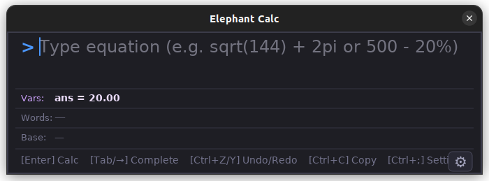
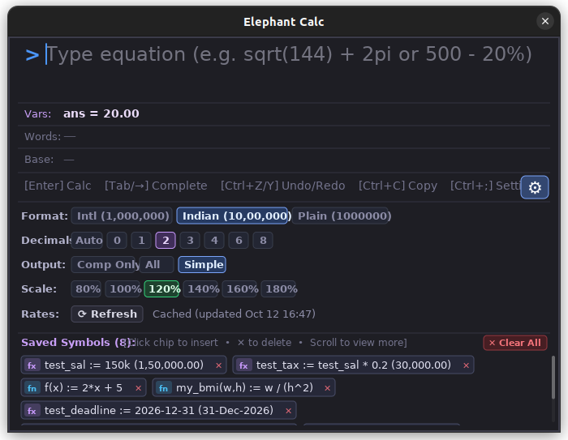

# Elephant Calc 🐘

[](https://kernel.org)
[](https://en.wikipedia.org/wiki/C11_(C_standard_revision))
[](LICENSE)
[](#-performance--benchmarks)
[](#-quality-assurance--testing)

A lightning-fast, keyboard-driven Spotlight calculator for Linux desktops. Written in pure **C11**, rendered directly to the screen via **Xlib**, **Cairo**, and **FreeType** with **zero web bloat**, instant cold launch (**< 120 ms** to first pixel), sub-microsecond calculation throughput (**15.5 µs / eval**), and a rich multi-row HUD.

<p align="center">
  
</p>

<h4 align="center">Expandable Configuration Drawer (<code>Ctrl + ;</code> or <code>⚙</code>)</h4>

<p align="center">
  
</p>

---

## ⚡ Why Elephant Calc?

Most modern calculators are either bloated Electron/web apps (consuming 250+ MB RAM and taking 2+ seconds to launch) or bare-bones terminal prompts. 

**Elephant Calc provides a native C alternative engineered for daily keyboard flow:**
- **Zero Web / Framework Bloat:** Compiled native C binary (~265 KB). No Electron, Python, Node, GTK, or Qt runtime dependencies.
- **Microsecond Evaluation Latency:** Evaluates **64,500+ expressions per second** (~15.5 µs per operation). Live recalculation on every keystroke takes < 0.1% of a single 60 FPS frame.
- **Spotlight-Style Workflow:** Floats unobtrusively in the center of your screen. Hit a global shortcut, calculate, and press `Ctrl+C` or `Enter` to dismiss.
- **Compound Unit & Calendar Intelligence:** Mix units naturally (`5ft 9in + 3in = 6 ft`, `5 hr 2 min in min = 302 min`, `business days between today and 15-Nov`).
- **Context-Aware Autocomplete:** Ranks suggestions dynamically based on preceding tokens and dimensional units.
- **Memory-Safe & Hardened:** Verified leak-free (0 bytes leaked under AddressSanitizer/LeakSanitizer) and immune to stack recursion overflows up to 1,000 nested parentheses.

---

## 🖥️ Visual HUD Architecture

Elephant Calc renders a focused 6-row information display:

```text
+-------------------------------------------------------------------------------+
| > (50 km in meters) + 15%                                                     | <- Row 1: Math Input (Full Width, Ghost-text Autocomplete)
+-------------------------------------------------------------------------------+
|                                                               = 57,500 meters | <- Row 2: Live Evaluated Result (Click to Copy)
+-------------------------------------------------------------------------------+
| ans = 57,500  •  tax = 18%  •  rate = 1,416                   [✕ Delete All] | <- Row 3: Variables Bar (Persistent ans + User Vars)
+-------------------------------------------------------------------------------+
| Fifty-Seven Thousand Five Hundred meters                                      | <- Row 4: Spoken Words (Drag across to copy)
+-------------------------------------------------------------------------------+
| Base: Hex: 0xE09C  •  Bin: 0b1110000010011100                                 | <- Row 5: Dedicated Computing Radix (Hex / Bin / Oct)
+-------------------------------------------------------------------------------+
| [Enter] Calc   [Tab] Complete   [Ctrl+C] Copy   [↑/↓] History   [⚙]           | <- Row 6: Shortcuts & Drawer Toggle
+-------------------------------------------------------------------------------+
```

### Contextual Autocomplete HUD
Typing a prefix displays inline ghost text and an interactive candidate preview bar:
```text
Input:  > 50 km in m|
HUD:    Tab: [meters]  •  meter  •  millimeters  •  ... (1/5)
Result: = 50,000 meters
```

### Expandable Configuration Drawer (`Ctrl + ;` or `⚙`)
```text
+-------------------------------------------------------------------------------+
| Format:   [Intl (1,000,000)]   [Indian (10,00,000)]   [Plain]          [1/2/3]|
| Decimals: [Auto]  [0]  [2]  [3]  [4]  [6]  [8]                     [d] Cycle  |
| Output:   [Comp-Only (Hex/Bin)]   [All (Dec/Hex/Bin)]   [Simple]      [c/a/s] |
| Scale:    [80%]  [100%]  [120%]  [140%]  [160%]  [180%]        [Ctrl +/- / 0] |
| Rates:    [ ⟳ Refresh ]  ✓ Up to date (1 USD = 83.42 INR)                     |
+-------------------------------------------------------------------------------+
```

---

## 🌟 Core Features

### 1. Smart Context-Aware Autocomplete
Unlike static alphabetical completion lists, Elephant Calc inspects preceding tokens and unit dimensions to rank completions:

| Context Detected | Preceding Pattern | Input Prefix | Top Suggestion | Prioritized Ahead Of |
|---|---|---|---|---|
| **Dimension Target** | `50 km in ` | `m` | `meters` | `min()`, `minutes`, `mod()` |
| **Timezone Target** | `now in ` | `t` | `tokyo` | `today`, `tan()` |
| **Currency Target** | `1500 usd in ` | `e` | `eur` | `exp()`, `emi()` |
| **Calendar Operator** | `5 days ` | `b` | `before` | `berlin` |
| **Math Operator** | `10 + ` | `s` | `sqrt()` | `seconds` |
| **Scale Multiplier** | `25 ` | `cr` | `crore` | `cbrt()` |
| **User Symbols** | (any context) | `cust` | `custom_tax` | Built-in symbols |

- **Ghost Text**: The top candidate is displayed inline as faint ghost text touching your cursor.
- **Tabbing & Cycling**: Press <kbd>Tab</kbd> to commit. If multiple matches exist, repeated <kbd>Tab</kbd> presses cycle through candidates in-place (`1/N`).
- **Mid-Buffer Insertion**: Autocomplete works cleanly anywhere within an expression.

---

### 2. Universal Compound Unit Systems
Elephant Calc natively parses, converts, and formats mixed multi-unit systems across time, length, and mass:

#### Time Domain
```text
> (5h+2min) in hr
5 hr 2 min
(Subtitle: 5.03333333 hours  •  302 minutes  •  18,120 seconds)

> (5h+2min) in min
302 min

> 5400 s in hr
1 hr 30 min
```

#### Imperial Length (`ft` & `in`)
Supports decimal conversions and adjacent natural notation:
```text
> 5.75 ft in ft
5 ft 9 in
(Subtitle: 69 in  •  5.75 ft  •  1.7526 m)

> 70 in in ft
5 ft 10 in

> 5ft 9in + 3in
6 ft
```

#### Imperial Mass (`lb` & `oz`)
```text
> 8.5 lb in lb
8 lb 8 oz
(Subtitle: 136 oz  •  8.5 lb  •  3.85553515 kg)

> 100 oz in lb
6 lb 4 oz

> 8lb 8oz + 12oz
9 lb 4 oz
```

---

### 3. Formulas, User Functions & Persistent Memory
Elephant Calc distinguishes between transient session values and persistent disk-backed formulas:

- **Session Assignment (`=`)**: Resets when Elephant Calc closes.
  ```text
  > price = 4500
  4,500
  ```
- **Persistent Assignment (`:=`)**: Persists across restarts in `~/.config/elephant-calc/saved_symbols.conf`.
  ```text
  > tax_rate := 18%
  0.18

  > annual_budget := 12 * 85000
  1,020,000
  ```
- **User-Defined Functions**: Define custom functions with up to 4 parameters:
  ```text
  > f(x) = x^2 + 2x + 1
  > f(5)
  36

  > hypot(a, b) := sqrt(a^2 + b^2)
  > hypot(3, 4)
  5
  ```
- **Continuous Reactive Evaluation**: Modifying underlying variables automatically updates dependent formulas in memory.
- **In-App Symbol Management**:
  - `vars` or `saved`: Lists all defined symbols.
  - `delete <name>` or `undef <name>`: Removes a defined symbol.

---

### 4. Intelligent Bracket Engine
- **Hierarchical Cut Cycling (Repeated `(`)**: When entering `(` before an existing expression (e.g., at `|10 + 20 * 30`), Elephant Calc cycles forward candidate closing cut points using two-tier ghost styling (`)` and `⦆`).
- **Retroactive Cut Cycling (Repeated `)`)**: Entering `)` when all brackets are balanced scans backward across operator boundaries, cycling candidate opening cuts (`(` and `⦅`).
- **Non-Modal Auto-Commit**: Typing operators (`+`, `-`, `*`, `/`), digits, or `Enter` automatically commits the active candidate bracket into real text.
- **Tolerant EOF Auto-Close**: Unclosed brackets at the end of input auto-close cleanly during evaluation (`sqrt(144` $\rightarrow$ `12`).

---

### 5. Date, Time & Calendar Calculations

| Expression | Result | Description |
|---|---|---|
| `between 2026-10-01 and 2026-10-31` | `30.00 days` | Date interval difference |
| `business days between 2026-10-01 and 2026-10-31` | `21 business days` | Working days excluding weekends |
| `3 days before 2026-10-25` | `22-Oct-2026` | Relative date offset in past |
| `days until 2026-12-31` | `80.00 days` | Duration countdown to future date |
| `days until tomorrow` | `1.00 day` | Dynamic landmark countdown |
| `today + 45 days to date` | `26-Nov-2026` | Calendar date 45 days in future |
| `(today + 5 day) to weekday` | `Saturday` | Day of week |
| `now to utc` | `12-Oct-2026 13:45:00 UTC` | Current timestamp formatted in UTC |
| `10-Sept-2026 to epoch` | `1788978600` | Unix epoch timestamp in seconds |

---

### 6. Global Timezone & DST Conversions

| Expression | Example Result | Description |
|---|---|---|
| `now in tokyo` | `12-Oct-2026 10:45:00 PM JST` | Converts current instant to Tokyo time |
| `now in est` | `12-Oct-2026 09:45:00 AM EDT` | Converts current instant to US Eastern Time |
| `14:30 in tokyo` | `12-Oct-2026 06:00:00 PM JST` | Converts 2:30 PM local time to Tokyo time |
| `5pm est in ist` | `Tomorrow, 13-Oct-2026 02:30:00 AM IST` | Cross-timezone with day-boundary shift tag |
| `02:00 in nyc` | `Yesterday, 11-Oct-2026 04:30:00 PM EDT` | Past day boundary shift tag |
| `now in utc+5:30` | `12-Oct-2026 07:15:00 PM UTC+05:30` | Numeric UTC offset conversion |

- **Words Row**: Full geographic region and weekday (`Tokyo, Japan • Monday`).
- **Computing Row**: Difference from local time, UTC offset, and Unix epoch.

---

### 7. Programmer Mode & Radix Conversions

| Input Expression | Result | Base Subtitle |
|---|---|---|
| `0xFF + 1` | `256` | `Hex: 0x100  •  Bin: 0b100000000` |
| `0b101010` | `42` | `Hex: 0x2A  •  Bin: 0b101010` |
| `0o77 + 1` | `64` | `Hex: 0x40  •  Bin: 0b1000000` |
| `~0` | `-1` | Bitwise 64-bit NOT |
| `0b1100 & 0b1010` | `8` | Bitwise AND (`0b1000`) |
| `0b1100 \| 0b0011` | `15` | Bitwise OR (`0b1111`) |
| `15 xor 7` | `8` | Infix bitwise XOR (or `xor(15, 7)`) |
| `1 << 10` | `1,024` | Bitwise left shift |
| `1024 >> 2` | `256` | Bitwise right shift |
| `255 to hex` | `0xFF` | Conversion to hexadecimal string |
| `42 to bin` | `0b101010` | Conversion to binary string |
| `100 to oct` | `0o144` | Conversion to octal string |
| `0xFF to dec` | `255` | Conversion to decimal string |

---

### 8. Financial & Loan Suite

| Function | Formula / Description | Example | Output |
|---|---|---|---|
| `emi(P, r, n)` | Monthly EMI for principal `P`, annual rate `r%`, `n` months | `emi(5000000, 8.5, 240)` | `43,391.16` |
| `sip(P, r, y)` | Systematic Investment Plan future value (`P`/mo, `r%` p.a., `y` yrs) | `sip(10000, 12, 10)` | `23,23,390.76` |
| `cagr(v_i, v_f, y)` | Compound Annual Growth Rate (`v_i` to `v_f` over `y` yrs) | `cagr(100000, 250000, 5)` | `20.11%` |
| `compound(P, r, y)` | Compound interest future value | `compound(100000, 7, 5)` | `1,40,255.17` |
| `discount(price, pct)` | Net amount after percentage discount | `discount(1200, 15)` | `1,020` |
| `markup(cost, margin)` | Selling price with profit margin percentage | `markup(100, 25)` | `125` |

---

### 9. Statistical Functions & Delimiter Intelligence

Multi-argument statistical functions parse arguments cleanly without requiring spaces between commas, while preserving verified thousands separators outside function parameters:

| Function | Description | Example | Output |
|---|---|---|---|
| `avg(x1, x2, ...)` | Arithmetic mean | `avg(10,20,30)` | `20` |
| `median(x1, x2, ...)` | Middle value of sorted sequence | `median(5, 1, 9, 3, 7)` | `5` |
| `min(x1, x2, ...)` | Minimum value (supports scales like `k`, `lakh`) | `min(50k, 20k, 90k)` | `20,000` |
| `max(x1, x2, ...)` | Maximum value | `max(15, 85, 42)` | `85` |

---

### 10. Dimensional Physical Units

Supports conversions across **10 physical dimensions** with automatic conversion hints:
- **Length**: `m`, `km`, `cm`, `mm`, `mi`, `yd`, `ft`, `in`
- **Mass**: `g`, `kg`, `mg`, `lb`, `oz`, `ton`
- **Time**: `s`, `min`, `h`, `d`, `week`, `year`
- **Data Storage**: `B`, `KB`, `MB`, `GB`, `TB`, `KiB`, `MiB`, `GiB`, `TiB`
- **Temperature**: `c`, `f`, `k` (affine temperature conversion)
- **Currency**: `USD`, `INR`, `EUR`, `GBP`, `JPY`, `CAD`, `AUD`, `CNY`, `CHF`, `AED`, `SGD` (background thread cached)
- **Speed**: `m/s`, `km/h`, `mph`, `knot`, `ft/s`
- **Area**: `sqm`, `sqkm`, `sqft`, `sqin`, `sqyd`, `acre`, `hectare`, `sqmi`
- **Data Transfer Rate**: `bps`, `kbps`, `mbps`, `gbps`, `B/s`, `KB/s`, `MB/s`, `GB/s`
- **Pressure**: `pa`, `kpa`, `bar`, `psi`, `atm`
- **Scale Multipliers**: `k` (1,000), `million` (1e6), `billion` (1e9), `lakh` (100,000), `crore` (10,000,000)

---

## ⌨️ Keyboard & Mouse Controls

### Readline / Emacs Navigation
| Shortcut | Action |
|---|---|
| <kbd>Ctrl</kbd> + <kbd>A</kbd> / <kbd>Ctrl</kbd> + <kbd>E</kbd> | Jump to start / end of expression |
| <kbd>Ctrl</kbd> + <kbd>B</kbd> / <kbd>Ctrl</kbd> + <kbd>F</kbd> | Move backward / forward by character |
| <kbd>Alt</kbd> + <kbd>B</kbd> / <kbd>Alt</kbd> + <kbd>F</kbd> | Move backward / forward by word |
| <kbd>Ctrl</kbd> + <kbd>U</kbd> / <kbd>Ctrl</kbd> + <kbd>K</kbd> | Delete from cursor to start / end of line |
| <kbd>Ctrl</kbd> + <kbd>W</kbd> | Delete previous word |
| <kbd>Ctrl</kbd> + <kbd>D</kbd> / <kbd>Ctrl</kbd> + <kbd>H</kbd> | Forward delete / Backward delete |
| <kbd>Ctrl</kbd> + <kbd>Z</kbd> / <kbd>Ctrl</kbd> + <kbd>Y</kbd> | Undo / Redo buffer modification |

### Actions & Settings
| Action | Shortcut / Gesture | Description |
|---|---|---|
| **Commit Suggestion** | <kbd>Tab</kbd> | Commits active autocomplete suggestion; cycles on repeat |
| **Commit Calculation** | <kbd>Enter</kbd> | Evaluates, saves to history, stores in `ans` |
| **Copy Result** | <kbd>Ctrl</kbd> + <kbd>C</kbd> | Copies green evaluated result to clipboard |
| **History Navigation** | <kbd>↑</kbd> / <kbd>↓</kbd> | Cycles through persistent equation history |
| **Bracket Cut Cycling** | <kbd>(</kbd> or <kbd>)</kbd> | Cycles proactive/retroactive bracket wraps |
| **Settings Drawer** | <kbd>Ctrl</kbd> + <kbd>;</kbd> or <kbd>⚙</kbd> | Toggles configuration tray |
| **Number Format** | <kbd>1</kbd> / <kbd>2</kbd> / <kbd>3</kbd> | International (`1,000,000`), Indian (`10,00,000`), or Plain |
| **Decimal Precision** | <kbd>d</kbd> | Cycles decimal places (`Auto` $\rightarrow$ `0` $\rightarrow$ `2` $\rightarrow$ `3` $\rightarrow$ `4` $\rightarrow$ `6` $\rightarrow$ `8`) |
| **Output Mode** | <kbd>c</kbd> / <kbd>a</kbd> / <kbd>s</kbd> | Comp-Only (`Hex • Bin`), All (`Dec • Hex • Bin`), Simple |
| **UI Scaling** | <kbd>Ctrl</kbd> + <kbd>+</kbd> / <kbd>-</kbd> / <kbd>0</kbd> | Zooms UI font between 80% and 180% |
| **Dismiss / Close** | <kbd>Escape</kbd> | Dismisses ghost text, closes drawer, or exits |
| **Drag-to-Copy Words** | Mouse Drag | Drag across words in Row 4; auto-copies on release |

---

## 💻 Headless CLI Mode

Elephant Calc includes a zero-overhead CLI mode for shell scripts and terminal pipelines:

```bash
# Basic math
./elephant-calc --eval "2^32 - 1"

# Unit conversion
./elephant-calc --eval "(5h+2min) in hr"
# Output: 5 hr 2 min

# Imperial length compounding
./elephant-calc --eval "5.75 ft in in"
# Output: 69 in

# Date intervals & business days
./elephant-calc --eval "business days between 2026-10-01 and 2026-10-31"
# Output: 21 business days

# Global timezone conversion
./elephant-calc --eval "5pm est in ist"
# Output: Tomorrow, 13-Oct-2026 02:30:00 AM IST

# Number formatting options
./elephant-calc --decimals 2 --indian --eval "1000000 + 500"
# Output: 10,00,500.00

# Plain unformatted output for shell variables
./elephant-calc --plain --eval "10^6"
# Output: 1000000

# Output with words and computing radix
./elephant-calc --eval "256" --words
# Output: Hex: 0x100  •  Bin: 0b100000000  •  Two Hundred Fifty Six

# List saved persistent variables & functions
./elephant-calc --vars

# Delete a saved persistent variable
./elephant-calc --delete-saved custom_tax
```

---

## 🚀 Performance & Benchmarks

Benchmarked on native Linux x86_64:

### 1. Cold Startup Latency (`./elephant-calc --benchmark`)
```text
Startup to first frame: 120.00 ms
  [Phase Breakdown]
  - Storage & history load:   4.47 ms
  - XOpenDisplay connection:  8.08 ms
  - Window creation & setup:  0.01 ms
  - Icon render & attach:     3.64 ms
  - Cairo surface & context:  3.23 ms
  - Window Manager mapping:  81.38 ms  (X11 compositor MapNotify/Expose roundtrip)
  - First frame render:      15.76 ms
      * Background & border:  2.12 ms
      * Font/text init:       1.98 ms
      * UI elements drawing:  8.74 ms
      * Buffer blit to X11:   2.81 ms
      * Final XFlush:         0.11 ms
```
- **Total Application CPU Setup Time:** **~38 ms**
- **Window Manager Ack Delay:** **~81 ms** (X11 compositor mapping roundtrip)

### 2. Math & Conversion Engine Throughput
```text
Evaluated 500,000 real-world operations in 7.748 seconds:
Engine Throughput: 64,533 evaluations / second
Average Latency:   15.50 µs per evaluation
```

---

## 🏗️ Architecture & Internals

Elephant Calc is designed as a pipeline with strict separation between predictive typing, math evaluation, and X11 display rendering:

```text
 ┌────────────────────────────────────────────────────────┐
 │ 1. USER INPUT (Keystroke Event)                        │
 └───────────────────────────┬────────────────────────────┘
                             ▼
 ┌────────────────────────────────────────────────────────┐
 │ 2. PREDICTIVE ENGINES (Evaluated on every keystroke)  │
 │  • autocomplete.c : Contextual token scoring & ranking │
 │  • brackets.c     : Hierarchical ghost bracket cuts    │
 └───────────────────────────┬────────────────────────────┘
                             ▼
 ┌────────────────────────────────────────────────────────┐
 │ 3. PARSING & EVALUATION CORE                           │
 │  • parser.c       : Recursive descent (expr->term->fac)│
 │  • convert.c      : Dimensional units & timezone map   │
 │  • currency.c     : Background thread exchange rates   │
 └───────────────────────────┬────────────────────────────┘
                             ▼
 ┌────────────────────────────────────────────────────────┐
 │ 4. FORMATTING, STATE & DISPLAY                         │
 │  • format.c       : Compound units, radix, words       │
 │  • storage.c      : Persistent ans & saved_symbols.conf│
 │  • undo.c         : Non-linear undo/redo ring buffer   │
 │  • main.c         : Cairo rasterization & X11 blit     │
 └────────────────────────────────────────────────────────┘
```

### Module Responsibility Map

| Module | Files | Responsibility |
|---|---|---|
| **Core Types** | [`elephant.h`](elephant.h) | `VNum` (atomic `double value` + `UnitItem *unit`), symbol registries, and token definitions. |
| **Predictive UX** | [`autocomplete.c`](autocomplete.c), [`brackets.c`](brackets.c) | Context-aware candidate ranking, dimension-aware unit completion, and AST bracket cut cycling. |
| **Math Evaluator** | [`parser.c`](parser.c) | Recursive descent parser, operator precedence, spaceless function delimiters, and user functions. |
| **Unit Engine** | [`convert.c`](convert.c), [`timezone.c`](timezone.c) | Physical dimension conversions, compound unit reductions, and IANA timezone/DST offsets. |
| **Background Rates**| [`currency.c`](currency.c) | Asynchronous pthread worker fetching live exchange rates with offline disk cache fallback. |
| **Formatting & State**| [`format.c`](format.c), [`storage.c`](storage.c), [`undo.c`](undo.c) | Decimal precision, Indian/Intl commas, spoken words, disk persistence (`:=`), and undo ring buffer. |
| **Display Server** | [`main.c`](main.c) | X11 event dispatching, Cairo HUD surface rendering, and FreeType glyph layout. |

### How to Navigate the Codebase in 10 Minutes
1. **Start at [`elephant.h`](elephant.h):** Review `VNum` and `UnitItem`. Understanding that numbers carry dimensional unit pointers through the parser explains how all conversions work.
2. **Trace the CLI Pipeline:** Read [`main.c:378-450`](main.c#L378-L450). It routes raw strings to either [`try_convert_expression()`](convert.c) or [`evaluate_equation_ex()`](parser.c) and outputs via [`format.c`](format.c).
3. **Explore the Predictive Engines:** Inspect [`detect_autocomplete_context()`](autocomplete.c) and [`bracket_cycle_proactive()`](brackets.c) to see how live keystrokes are analyzed without blocking the UI.

---

## 🧪 Quality Assurance & Testing

Elephant Calc includes a comprehensive test suite covering mathematical boundaries, buffer stress, recursion limits, and operating system isolation:

### Running the Test Suite
```bash
# 1. Run local robustness test suite (<0.5 seconds):
./test_realworld.sh

# 2. Run clean OS-isolation test inside Docker (Ubuntu 22.04 container):
./test_realworld.sh --docker
```

### Verified Robustness Vectors
- **Division by Zero:** `1/0` and `0/0` caught cleanly without SIGFPE.
- **Floating-Point Limits:** `pow(10,300) * pow(10,300)` yields `Infinity` cleanly without overflow traps.
- **Deep Parentheses Recursion:** Verified immune to stack overflows up to **1,000 nested parentheses** (`((((...1...))))`).
- **Buffer Overflow Resistance:** Verified with **2,001-character equations** (500 additions) with 0 memory errors.
- **Memory Safety (ASan/LSan):** Built with `-fsanitize=address,undefined` — **0 memory leaks** and **0 undefined behaviors** detected across 200 consecutive stress evaluations.
- **Headless Isolation:** Evaluates headless when `$DISPLAY` is absent (CLI exits code 0; GUI cleanly reports `Error: cannot open DISPLAY` with exit code 1 without crashing).

---

## 📦 Installation & Setup

### 1. Install Build Dependencies

#### Ubuntu / Debian / Linux Mint:
```bash
sudo apt update
sudo apt install build-essential libx11-dev libcairo2-dev libfreetype6-dev
```

#### Fedora / RHEL:
```bash
sudo dnf install gcc make libX11-devel cairo-devel freetype-devel
```

#### Arch Linux / Manjaro:
```bash
sudo pacman -S base-devel libx11 cairo freetype2
```

---

### 2. Build from Source
```bash
git clone https://github.com/deepanshu44/elephant-calc.git
cd elephant-calc
make
```

### 3. Install Globally
```bash
sudo install -m 755 elephant-calc /usr/local/bin/elephant-calc
```

---

## 🖥️ Desktop & Window Manager Integration

### Desktop Launcher (`.desktop`)
To launch Elephant Calc from application menus (GNOME Dash, KDE Kickoff, Rofi, dmenu):

Create `~/.local/share/applications/elephant-calc.desktop`:
```desktop
[Desktop Entry]
Name=Elephant Calc
Comment=Ultra-fast Spotlight Calculator
Exec=elephant-calc
Icon=accessories-calculator
Terminal=false
Type=Application
Categories=Utility;Calculator;
StartupNotify=true
```

### Global Hotkey Configuration

#### GNOME Desktop:
1. Open **Settings** $\rightarrow$ **Keyboard** $\rightarrow$ **Keyboard Shortcuts** $\rightarrow$ **Custom Shortcuts**.
2. Click **+** (Add Shortcut):
   - **Name**: `Elephant Calc`
   - **Command**: `elephant-calc`
   - **Shortcut**: `Super + Space` (or `Super + C`)

#### KDE Plasma:
1. Open **System Settings** $\rightarrow$ **Shortcuts** $\rightarrow$ **Custom Shortcuts**.
2. Add a new **Global Shortcut** $\rightarrow$ **Command/URL**.
3. Set action to `elephant-calc` and trigger to `Meta + Space`.

#### Tiling Window Managers (i3 / Sway / Hyprland):
- **i3 / Sway (`~/.config/i3/config` or `~/.config/sway/config`):**
  ```i3config
  bindsym $mod+c exec --no-startup-id elephant-calc
  for_window [class="elephant-calc"] floating enable
  ```
- **Hyprland (`~/.config/hypr/hyprland.conf`):**
  ```conf
  bind = $mainMod, C, exec, elephant-calc
  windowrulev2 = float, class:^(elephant-calc)$
  ```

---

## 📄 License

This project is licensed under the [MIT License](LICENSE) — free for personal and commercial use.
